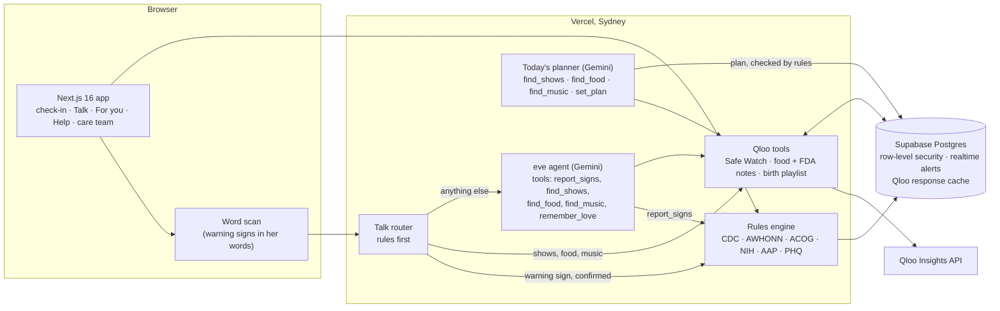

# Momwell

**From first heartbeat to first birthday, Momwell keeps watch.**

Momwell is a care companion for pregnancy and the year after birth. Every day it checks the CDC's urgent maternal
warning signs with her, tells her exactly who to call and what to say, and brings her partner, family and care team
in at the moment they are needed. It knows what she loves through Qloo, so it brings her something made for her every
day: a gentle show, food that fits her diet with the FDA's advice for pregnancy, calm music for the hospital bag. That
is why she keeps coming back, and a daily check-in is how a warning sign gets caught in time.

**Live:** https://momwell-one.vercel.app · **Try it:** open the demo and press *Open Momwell as Maya*. You get your own
demo family (Maya at 27 weeks, her partner Sam, her OB-GYN Dr Lee) and can switch between them, or move Maya to six
weeks after the birth, with one tap. All demo data is made up.

## Why it matters

- **4 in 5** pregnancy-related deaths in the US were judged preventable by the committees that review them
  ([CDC, Maternal Mortality Review Committees, 2020](https://archive.cdc.gov/www_cdc_gov/maternal-mortality/php/data-research/index.html)).
- **1 in 4** of those deaths had a mental health condition among the circumstances that contributed
  ([CDC, 2020](https://archive.cdc.gov/www_cdc_gov/maternal-mortality/php/report/index.html)).
- Black mothers in the US die at about **3 times** the rate of White mothers
  ([NCHS, 2024](https://www.cdc.gov/nchs/data/hestat/hestat113.htm)).

Most of these deaths follow a warning sign that nobody acted on in time. Momwell is built so that the sign is noticed,
the right person is called, and the people around her know.

## What it does

**For her**
- **A thirty-second check-in** against the CDC's 15 urgent maternal warning signs, with blood pressure and temperature.
  The signs shown follow her stage: pregnancy, the six weeks after birth, or the rest of the first year.
- **The right call, not always 911.** AWHONN's POST-BIRTH guidance says which signs mean calling 911 (chest pain,
  trouble breathing, thoughts of hurting yourself) and which mean calling her doctor now; NIH sets 160/110 as the
  emergency line for blood pressure. Her doctor and partner are one tap away, with the words to say ("I am 27 weeks
  pregnant, and I am having…"), CDC's steps for getting care, and breathing along with her while she waits.
- **Talk to Momwell** in her own words, typed or spoken. Rules answer at once: a warning sign is asked about before
  anything is recorded, thoughts of harm bring 988 and the maternal mental health hotline straight away, and how she
  feels gets a kind answer with a next step.
- **A mood check every two weeks** with the PHQ-2 and, when it points that way, the PHQ-9 (ACOG's guideline). She sees
  what to do, never a label.
- **Her baby's check-in** for the first year, from the AAP and Children's Hospital Colorado: 100.4°F under three months,
  blue lips, no wet diaper in eight hours, and more.
- **For you, through Qloo:** Safe Watch (shows like the ones she loves, with loss, grief and pregnancy scares left
  out), places to eat near her that fit her diet with what to ask for, and a calm birth playlist.
- **Today's plan:** Momwell's planner asks Qloo for shows, places to eat and music from her taste, chooses one
  evening and writes a note to her and one to her family (bring dinner from the place it chose). Rules keep only what
  Qloo returned and drop any note about her health; when the model can't answer, the rules put it together from
  Qloo's first picks and say so. Above it, the rules decide what comes first today: an open warning sign, her
  check-in, or her mood check. Every step is one tap away under *How Momwell made this*.
- **Help from her people:** she asks for a meal, the night feeds, groceries or a ride; they take it with one tap, and
  a dinner ask comes with places she would love.

**For her partner and family:** an alert the moment she needs them, without the private detail unless she shares it,
a one-tap call to her, her asks to take on, today's plan for her evening, and her warning signs with which mean 911.

**For her care team:** patients as a triage queue (urgent and unseen first, then call-her, then quiet for three days),
blood pressure against the 140/90 and 160/110 lines, her mood checks, and a visit summary to print.

**She decides who sees what.** Every person she links sees only the scopes she grants (alerts, check-ins, mood, baby,
ways to help), enforced by row-level security in the database, not by the app.

## How it is built



**The model never decides a warning sign.** A word scan in the browser and a router on plain rules notice signs in
what she says; she confirms them; the TypeScript rules engine decides the level from official lists, every rule with
its source and the engine version. Every check-in has a *How this was decided* view: her words or her taps, each rule
that fired with its source, which call it showed and why, who was told, and whether her care team has seen it.

**Qloo is the companion's tools.** The eve agent calls `find_shows`, `find_food` and `find_music`; Talk's rules call
the same tools straight away for the requests they recognise. Every Qloo answer passes through tested rules before
she sees it: Safe Watch drops upsetting themes by tag, food must be a real meal (no bars, malls or event halls) and fit
her diet, and each place carries the FDA's advice as rules. Responses are cached in Postgres, so repeat questions are
instant and spend no quota. Every place Qloo made the choice carries a *Powered by Qloo* mark.

**Stack:** Next.js 16 (App Router, React 19), Supabase (Postgres, Auth, row-level security, realtime), eve with
Gemini, Qloo Insights, recorded voice lines (Gemini TTS), Vercel.

## Where things live

| Folder | What is in it |
| --- | --- |
| `lib/safety` | The rules: warning signs by stage, blood pressure and temperature, which call (911 or her doctor), what to say, mood (PHQ-2/9), baby signs, the audit trail |
| `lib/talk` | Talk's router (crisis, signs, Qloo requests, feelings) and its fixed replies |
| `lib/qloo` | The Qloo client and cache, Safe Watch, food rules with FDA notes, music, and the shared picks |
| `lib/plan` | Today's planner, its checks and its rules fallback |
| `lib/people` | Links, scopes, invites, phones and who a warning screen can call |
| `lib/care` | The care team's triage queue and wording |
| `lib/help` | Asks to her circle |
| `lib/demo` | The demo family, the ready pool and the guided tour |
| `agent` | The eve companion: instructions and tools |
| `app/(app)` | Pages: today, check-in, talk, for-you, help, mood, baby, people, signs, patients |
| `db/migrations` | Every table, row-level security policy and function, in order (001 to 018) |
| `evals` | Agent evals |
| `e2e` | Browser tests for every role |

## Measured

| What | Result |
| --- | --- |
| Warning signs found in 40 labelled messages (word scan and Talk router) | 40 of 40 |
| Everyday messages wrongly flagged (20 labelled) | 0 of 20 |
| Companion over the same 60 messages (model path) | 60 of 60 |
| Unit tests | 182 |
| Row-level security, planner and Qloo integration tests | 41 |
| Browser tests across mother, partner and care team | 26 |
| Agent evals (crisis, no diagnosis, no medicine advice, injection, Spanish, baby signs and more) | 12 suites |

## Run it

```bash
npm install
cp .env.example .env.local   # Supabase, Qloo and Gemini keys
npm run migrate              # db/migrations, in order
npm run dev
npm test                     # unit tests
npm run test:integration     # against your Supabase project
npm run e2e                  # browser tests (E2E_URL=http://localhost:3000)
npx eve eval                 # agent evals
```

## Scope

Momwell gives information from official lists and helps her reach care. It does not diagnose and does not suggest
medicines. In an emergency, call 911.

MIT licence.
